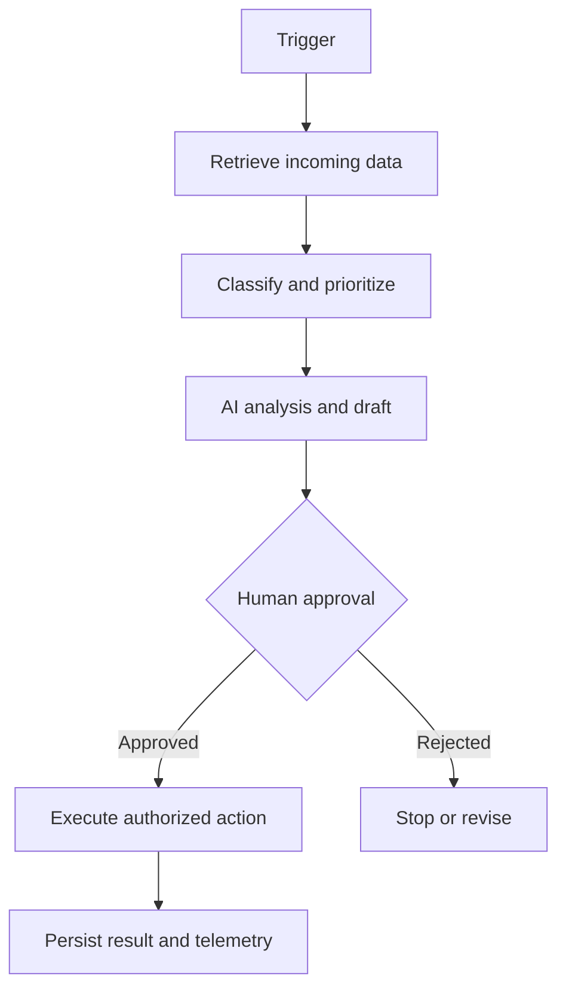
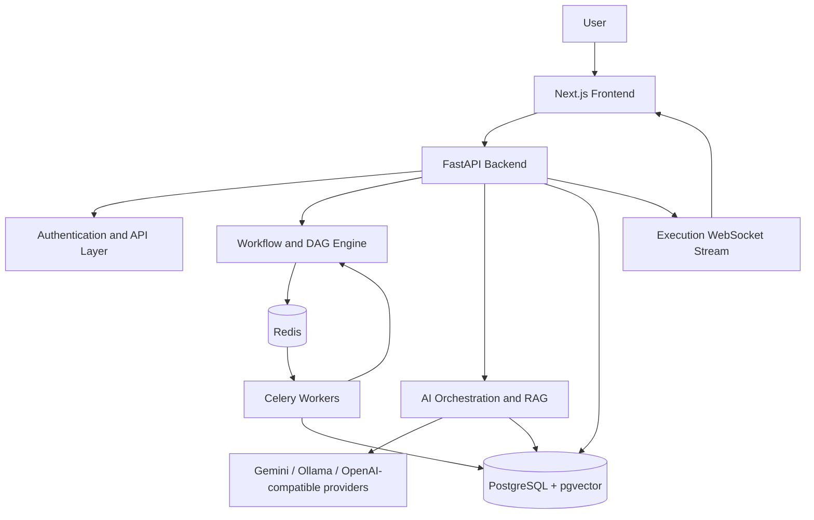
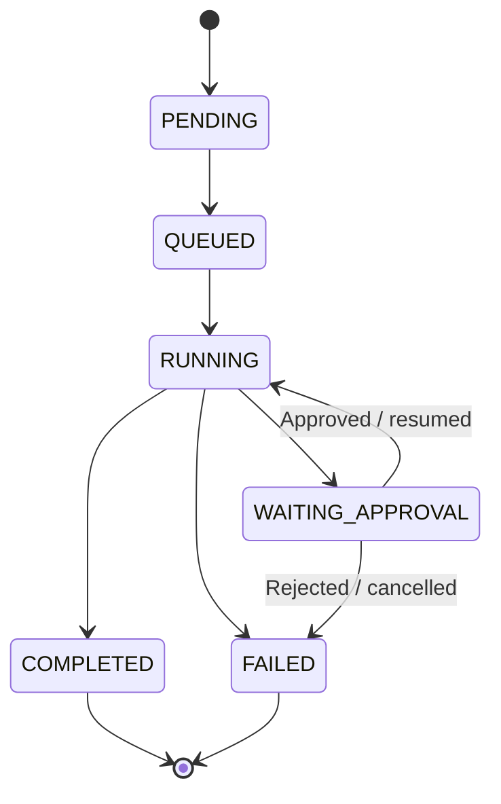

# FlowPilot AI

<p align="center">
  <strong>Design, orchestrate, and observe AI-powered workflows — from one visual workspace.</strong>
  <br />
  Turn natural-language goals into editable workflows, run them with durable AI agents, and keep people in control of consequential actions.
</p>

<p align="center">
  <a href="https://nextjs.org/"></a>
  <a href="https://react.dev/"></a>
  <a href="https://fastapi.tiangolo.com/"></a>
  <a href="https://www.postgresql.org/"></a>
  <a href="https://redis.io/"></a>
  <a href="https://www.docker.com/"></a>
</p>

<p align="center">
  <a href="#-overview">Overview</a> ·
  <a href="#-features">Features</a> ·
  <a href="#-architecture">Architecture</a> ·
  <a href="#-getting-started">Getting started</a> ·
  <a href="#-configuration">Configuration</a> ·
  <a href="#-development">Development</a>
</p>

---

## ✨ Overview

**FlowPilot AI** is an AI-powered workflow automation platform that combines a visual workflow builder, natural-language workflow generation, multi-agent orchestration, retrieval-augmented generation (RAG), and durable asynchronous execution.

Instead of treating an AI workflow as a single prompt, FlowPilot models it as an executable **directed acyclic graph (DAG)**. Each node performs a defined task, execution state is persisted, and sensitive steps can pause for human review before continuing.

### Why FlowPilot?

- **Build visually:** Compose workflows on an interactive canvas.
- **Start with a goal:** Generate a structured workflow from a natural-language instruction.
- **Coordinate AI tasks:** Route work through specialized agents and configurable model providers.
- **Stay in control:** Pause execution for human approval before sensitive actions.
- **Understand every run:** Inspect execution states, outputs, and operational telemetry.

---

## 🚀 Features

| Capability | What it does |
|---|---|
| **Visual Workflow Studio** | Build and edit node-based workflows on an interactive canvas powered by XYFlow. |
| **AI Workflow Generation** | Convert natural-language goals into structured workflow plans and DAGs. |
| **Multi-Agent Runtime** | Coordinate planning, analysis, execution, validation, and supervision tasks. |
| **Workflow Execution Engine** | Validate graph dependencies, execute nodes in order, and track state transitions. |
| **Durable Background Jobs** | Use Celery and Redis for asynchronous execution and scheduled recovery tasks. |
| **Human-in-the-Loop** | Suspend workflows at approval gates and resume after a reviewer decision. |
| **RAG Knowledge Base** | Ingest supported documents, retrieve relevant chunks using pgvector, and ground AI responses in source material. |
| **Model Provider Integration** | Configure supported AI providers, including Gemini, Ollama, and OpenAI-compatible endpoints. |
| **Execution Observability** | Inspect run status, node-level activity, outputs, and execution telemetry. |
| **Application Security** | Apply password hashing, token-based authentication, encrypted credentials, and security response headers. |

---

## 🧭 Example workflow

A user asks:

> Review incoming emails, identify urgent messages, summarize the important ones, and prepare replies for my approval.

A FlowPilot workflow can represent that process as:



The approval step is an explicit control point: the workflow can wait for a decision rather than automatically performing a sensitive action.

---

## 🏗️ Architecture

FlowPilot separates the user interface, API layer, workflow execution, AI services, and infrastructure.



### Main components

| Layer | Technology | Responsibility |
|---|---|---|
| Frontend | Next.js, React, TypeScript | Workflow studio, dashboards, approvals, and user experience |
| Graph editor | XYFlow | Interactive node-based workflow composition |
| API | FastAPI, Pydantic | REST endpoints, validation, authentication, and application services |
| Workflow engine | Python | DAG validation, node execution, and workflow state management |
| AI layer | Provider adapters and agent orchestration | Model calls, structured AI tasks, and agent coordination |
| Retrieval | PostgreSQL, pgvector | Document storage and vector similarity search |
| Background processing | Celery, Redis | Asynchronous jobs, workers, and scheduled tasks |
| Infrastructure | Docker Compose | Local multi-service development environment |

### Execution lifecycle

A workflow run moves through persisted execution states. The exact path depends on its nodes and approval requirements.



---

## 🧰 Technology stack

**Frontend**
- Next.js 16 and React 19
- TypeScript
- XYFlow (`@xyflow/react`)
- Tailwind CSS
- TanStack Query and Zustand
- Recharts and Framer Motion

**Backend**
- Python 3.13
- FastAPI and Pydantic
- SQLAlchemy 2.x and Alembic
- Celery and Redis
- PyJWT, Argon2, and cryptography

**Data and infrastructure**
- PostgreSQL 17
- pgvector
- Docker and Docker Compose

**AI and retrieval**
- Gemini integration
- Ollama support
- OpenAI-compatible provider support
- Document ingestion and vector retrieval

---

## ⚡ Getting started

The recommended way to run the complete application locally is with Docker Compose.

### Prerequisites

- Git
- Docker Desktop (or Docker Engine) with the Compose plugin
- An AI provider API key if you want to use a hosted model; local/mock options may be used where configured

### 1. Clone the repository

```bash
git clone https://github.com/BallapuramPrakashRoyal/FlowPilotAI.git
cd FlowPilotAI
```

### 2. Create your environment file

**Windows PowerShell**
```powershell
Copy-Item .env.example .env
```

**macOS / Linux**
```bash
cp .env.example .env
```

Open `.env` and configure the values you need. At minimum, review the database credentials and application secrets before running the application.

### 3. Start the application

```bash
docker compose up --build -d
```

This starts the application services defined in Compose, including:

- Next.js frontend
- FastAPI backend
- PostgreSQL with pgvector
- Redis
- Celery worker
- Celery scheduler

### 4. Open FlowPilot

| Service | Local URL |
|---|---|
| Frontend | [http://localhost:3000](http://localhost:3000) |
| Backend API | [http://localhost:8000](http://localhost:8000) |
| Interactive API docs | [http://localhost:8000/docs](http://localhost:8000/docs) |
| Backend health | [http://localhost:8000/health](http://localhost:8000/health) |
| Backend readiness | [http://localhost:8000/ready](http://localhost:8000/ready) |

### 5. View service logs

```bash
docker compose logs -f
```

To stop the services:

```bash
docker compose down
```

To stop the services and remove persisted database/cache volumes (this permanently deletes local persisted data):

```bash
docker compose down -v
```

---

## 🔧 Configuration

FlowPilot reads its environment configuration from the root `.env` file when running through Docker Compose. Use `.env.example` as the starting point.

| Variable | Purpose |
|---|---|
| `POSTGRES_USER` | PostgreSQL username |
| `POSTGRES_PASSWORD` | PostgreSQL password |
| `POSTGRES_DB` | PostgreSQL database name |
| `DATABASE_URL` | Async database connection string |
| `SYNC_DATABASE_URL` | Synchronous database connection string |
| `REDIS_URL` | Redis connection string |
| `SECRET_KEY` | Application signing secret |
| `CREDENTIAL_ENCRYPTION_KEY` | Key used to encrypt stored credentials |
| `GEMINI_API_KEY` | Gemini API credential, when using Gemini |
| `OPENAI_API_KEY` | API credential for a configured OpenAI-compatible provider |
| `OLLAMA_BASE_URL` | Ollama server URL |
| `GOOGLE_CLIENT_ID` | Optional Google OAuth client ID for Gmail integration |
| `GOOGLE_CLIENT_SECRET` | Optional Google OAuth client secret |
| `GOOGLE_REDIRECT_URI` | OAuth callback URL |
| `NEXT_PUBLIC_API_URL` | Backend URL used by the frontend |

> [!IMPORTANT]
> The values in `.env.example` are for local development. Replace development secrets and passwords before deploying anywhere shared or public. Never commit your real `.env` file, API keys, OAuth secrets, or production credentials.

---

## 🧪 Development

You can run the frontend and backend separately while keeping PostgreSQL and Redis in Docker.

### Start infrastructure

From the repository root:

```bash
docker compose up -d postgres redis
```

### Run the backend

```bash
cd backend
python -m venv .venv
```

Activate the environment:

**Windows PowerShell**
```powershell
.\\.venv\\Scripts\\Activate.ps1
```

**macOS / Linux**
```bash
source .venv/bin/activate
```

Install dependencies and start the API:

```bash
pip install -r requirements.txt
uvicorn app.main:app --reload --port 8000
```

### Run the frontend

In a separate terminal:

```bash
cd frontend
npm install
npm run dev
```

The frontend development server runs at [http://localhost:3000](http://localhost:3000).

### Useful commands

| Task | Command | Directory |
|---|---|---|
| Backend tests | `pytest -v` | `backend/` |
| Frontend lint | `npm run lint` | `frontend/` |
| Frontend production build | `npm run build` | `frontend/` |
| Start all services | `docker compose up --build -d` | Repository root |
| Follow service logs | `docker compose logs -f` | Repository root |

---

## 📁 Project structure

```text
FlowPilotAI/
├── backend/
│   ├── app/
│   │   ├── api/v1/          # Versioned API routes
│   │   ├── ai/              # AI providers, agents, and RAG services
│   │   ├── core/             # Configuration, security, and database setup
│   │   ├── database/         # ORM models and database initialization
│   │   ├── engine/           # Workflow graph and execution engine
│   │   ├── integrations/     # External service integrations
│   │   ├── schemas/          # Request and response schemas
│   │   └── workers/          # Celery worker and scheduled tasks
│   ├── alembic/              # Database migrations
│   ├── tests/                # Backend test suite
│   ├── Dockerfile
│   └── requirements.txt
├── frontend/
│   ├── src/
│   │   ├── app/              # Next.js App Router
│   │   ├── components/       # Shared UI components
│   │   ├── features/         # Product feature modules
│   │   ├── services/         # API client and service layer
│   │   └── types/            # TypeScript types
│   ├── Dockerfile
│   └── package.json
├── docker-compose.yml
├── .env.example
└── README.md
```

---

## 🔐 Security considerations

Security is part of the application design:

- Password hashing with Argon2.
- JWT-based authentication.
- Encryption support for stored credentials.
- Security-related HTTP response headers.
- Human approval gates for sensitive workflow actions.
- Docker services for PostgreSQL and Redis bound to localhost ports in the Compose configuration.

For production deployments, use managed secrets, strong unique credentials, HTTPS, restricted network access, least-privilege service accounts, and a reviewed deployment configuration. The local Compose setup is a development starting point, not a substitute for a production security review.

---

## 🗺️ Roadmap

Potential areas for continued development:

- [ ] Expand the workflow node and integration catalog.
- [ ] Improve workflow templates and reusable subflows.
- [ ] Add richer execution analytics and cost visibility.
- [ ] Expand evaluation and regression testing for AI-generated workflows.
- [ ] Improve deployment, backup, and operational documentation.

---

## 🤝 Contributing

Contributions, bug reports, and feature suggestions are welcome.

1. Fork the repository.
2. Create a feature branch: `git checkout -b feat/your-feature`.
3. Make your changes and run the relevant tests and checks.
4. Commit your work: `git commit -m "feat: describe your change"`.
5. Push the branch and open a pull request.

For bugs and feature requests, use the [GitHub Issues](https://github.com/BallapuramPrakashRoyal/FlowPilotAI/issues) page.

---

## 📌 Project status

FlowPilot AI is an actively developed project. Features, APIs, and configuration may evolve as the platform progresses.

---

<p align="center">
  <strong>FlowPilot AI</strong><br />
  <sub>From natural-language intent to observable AI workflows.</sub><br />
  <a href="https://github.com/BallapuramPrakashRoyal/FlowPilotAI">Repository</a>
</p>
