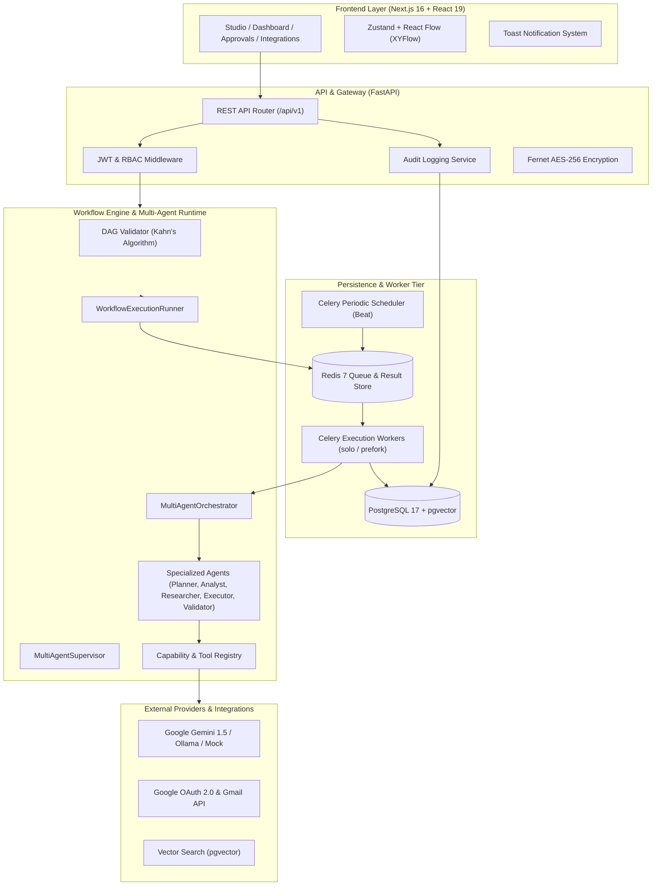
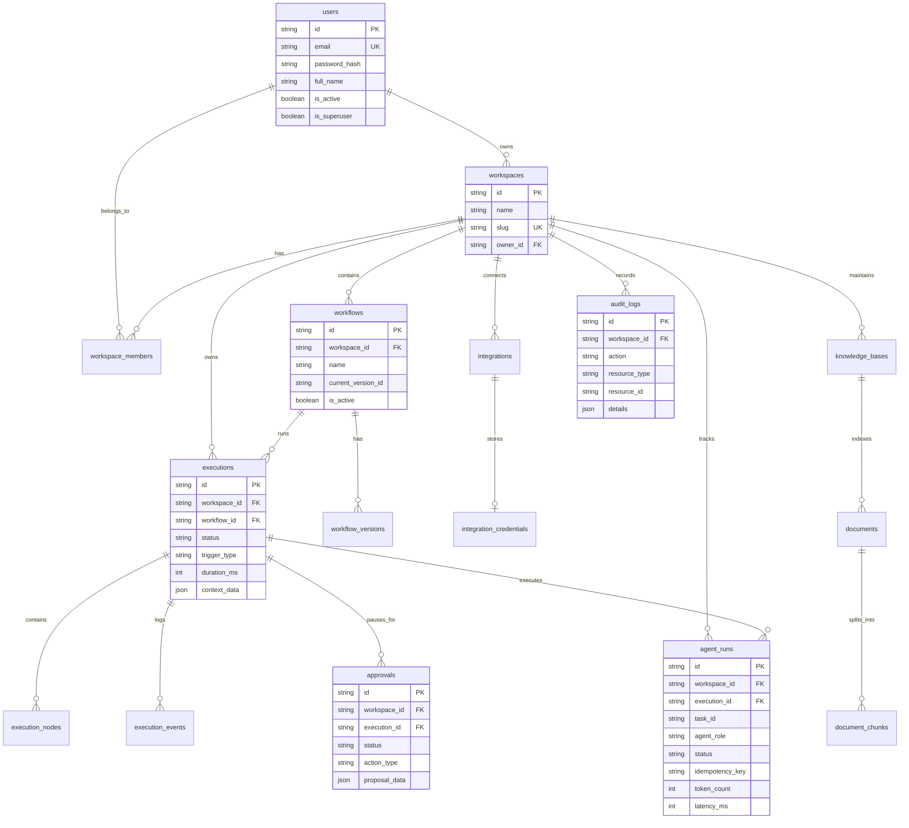
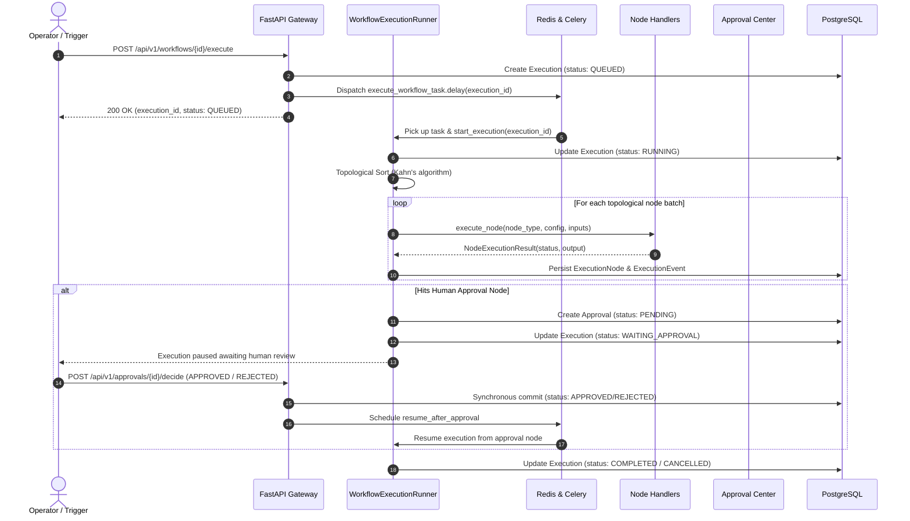
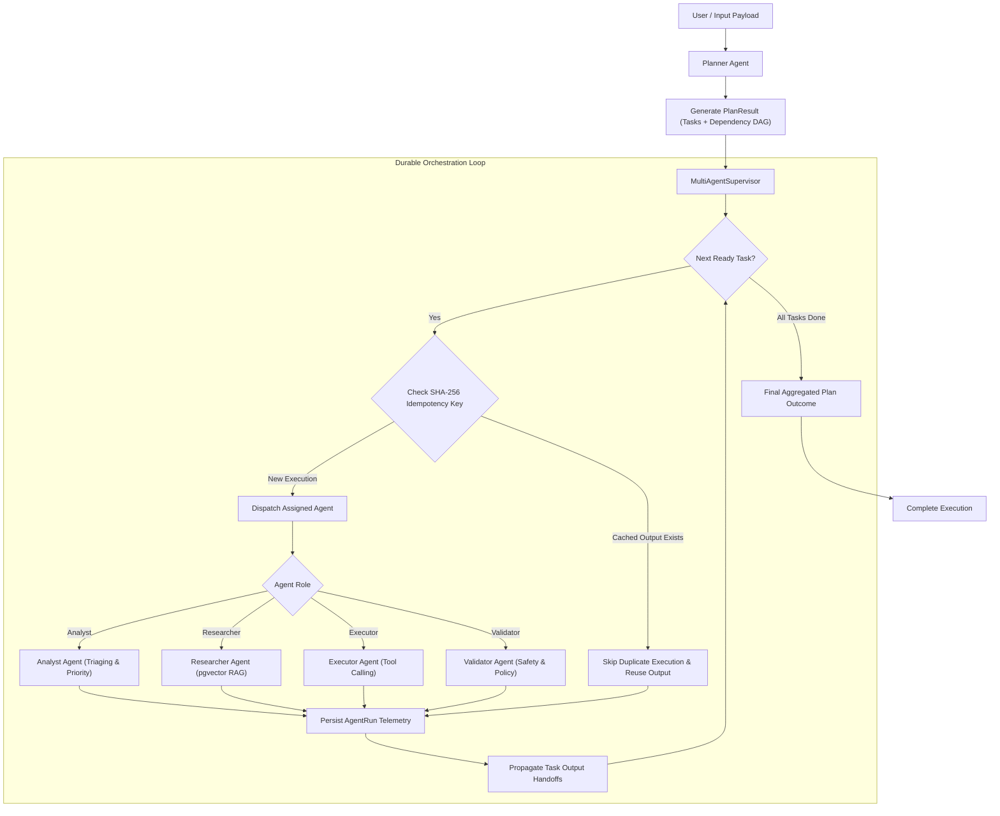

# FlowPilot AI — Architectural Design & Specification

## 1. High-Level Architecture

FlowPilot AI is engineered as a **Modular Monolith** combining an asynchronous, recoverable directed acyclic graph (DAG) execution engine, multi-agent AI orchestration runtime, and a reactive visual workflow studio.



---

## 2. Database Relationship Diagram



---

## 3. Main Workflow Execution Sequence



---

## 4. Multi-Agent Orchestration Flow



---

## 5. Setup & Development Instructions

### Prerequisites
- Python 3.13+
- Node.js 22+ & npm 10+
- PostgreSQL 17 with `pgvector` extension
- Redis 7+

### Backend Setup
```bash
cd backend
python -m venv .venv
source .venv/bin/activate  # Or on Windows: .venv\Scripts\Activate.ps1
pip install -r requirements.txt

# Run migrations
alembic upgrade head

# Start background worker (Windows solo pool, or default on Linux)
celery -A app.workers.celery_app worker --loglevel=info -P solo

# Start scheduler
celery -A app.workers.celery_app beat --loglevel=info

# Start FastAPI server
uvicorn app.main:app --host 0.0.0.0 --port 8000
```

### Frontend Setup
```bash
cd frontend
npm ci
npm run dev
# Browse to http://localhost:3000
```

---

## 6. Known Limitations & Production Constraints

1. **Celery Worker on Windows**:
   - Python's `prefork` process pool is unsupported on Windows. Workers on Windows must run with `--pool=solo` or `--pool=threads`. In Linux / Docker deployments, standard `prefork` or `gevent` pools should be utilized.
2. **Google OAuth Verification**:
   - Live Google token exchanges require valid `GOOGLE_CLIENT_ID` and `GOOGLE_CLIENT_SECRET` credentials registered in Google Cloud Console. When unconfigured, FlowPilot displays a real connection-required state rather than simulating fake email traffic.
3. **Database Concurrency in Fallback Mode**:
   - The primary storage engine is PostgreSQL with `pgvector`. In SQLite fallback mode, concurrent writes are serialized using SQLite's write-ahead log (`WAL`).
