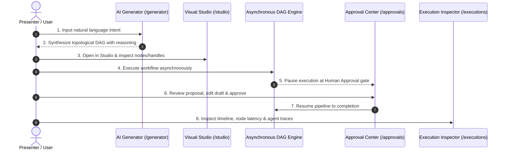

# FlowPilot AI — Portfolio & Demo Presentation Guide

## 1. Demo Walkthrough Overview

This guide provides a structured 10-minute presentation script demonstrating the complete capabilities of FlowPilot AI, from natural language prompt synthesis to human-in-the-loop autonomous execution.

---

## 2. Step-by-Step Demo Script

### Step 1: Login & Dashboard Overview (`/`)
1. Open `http://localhost:3000`.
2. Authenticate using the demo account credentials:
   - **Email**: `demo@flowpilot.ai`
   - **Password**: `FlowPilot2026!`
3. Highlight the live SaaS Dashboard:
   - Point out that **all metrics are computed live from database queries** (zero fabricated statistics).
   - Show KPI cards: Total Workflows, Active Workflows, Success/Failure Rates, Token Consumption, and Latency.
   - Show the 7-day Execution Velocity chart and recent Agent Activity feed.

### Step 2: Interactive Guided Onboarding (`/onboarding`)
1. Click **"Interactive Guided Setup"** on the hero banner or sidebar.
2. Step through the 7-step wizard:
   - **Step 1 (Workspace)**: Confirm tenant name (`Acme Autonomous Ops`).
   - **Step 2 (AI Engine)**: Show provider flexibility (Deterministic Mock, Gemini 1.5, Ollama).
   - **Step 3 (Integrations)**: Highlight optional Google Gmail connection with "Skip for now".
   - **Step 4 (Templates)**: Browse the 7 functional production templates.
   - **Step 5 (Workflow)**: Preview the topological node sequence.
   - **Step 6 (Execute)**: Click **"Run Test Execution"** to dispatch Celery worker task.
   - **Step 7 (Results)**: Observe the instant execution telemetry and click **"Enter FlowPilot Dashboard"**.

### Step 3: Natural Language AI Workflow Generator (`/generator`)
1. Navigate to `/generator`.
2. Enter a natural language workflow prompt:
   > *"When an urgent customer support inquiry arrives, analyze the urgency score, search our knowledge base for resolution policies, draft an executive response, and pause for my approval before sending."*
3. Click **"Generate Workflow Graph"**.
4. Observe the AI Planner synthesizing:
   - Step-by-step reasoning tree.
   - Validated DAG nodes and connections.
5. Click **"Open in Studio"** to transition seamlessly to the Visual Canvas.

### Step 4: Visual Workflow Studio (`/studio`)
1. In the infinite canvas:
   - Pan and zoom across the generated node hierarchy.
   - Click the **AI Intent Classifier** node to inspect its category configuration (`Urgent`, `Billing`, `General`).
   - Click the **Human Approval** node to show the `SEND_GMAIL_MESSAGE` action gate.
2. Demonstrate usability features:
   - Click **"Validate DAG"**: Observe Kahn's algorithm cycle check returning green.
   - Add a node from the left palette (e.g., `delay` or `notification`).
   - Test Undo (`Ctrl+Z`) and Redo (`Ctrl+Y`) keyboard shortcuts.
3. Click **"Save Workflow"** and then **"Execute Run"**.

### Step 5: Human-in-the-Loop Approval Center (`/approvals`)
1. Notice the red notification badge on the sidebar (`Approvals: 1`).
2. Navigate to `/approvals`.
3. Select the pending approval request:
   - Show the proposed email draft with subject, recipient, and generated body.
   - Demonstrate **Inline Proposal Editing**: Modify the draft message directly.
4. Test Rejection vs Approval:
   - Explain security invariant: Rejection halts execution with `CANCELLED` and guarantees zero external side effects.
   - Click **"Approve & Resume"**.

### Step 6: Observability & Agent Tracing (`/executions`)
1. Navigate to `/executions`.
2. Select the completed execution to open the Inspector:
   - Horizontal step timeline with execution duration in milliseconds.
   - Detailed per-node input/output inspector.
   - **Agent Observability Trace**: Review role, tokens consumed, latency, prompt injection validation findings, and cryptographic idempotency key.

### Step 7: Knowledge Base & Vector RAG (`/knowledge`)
1. Navigate to `/knowledge`.
2. Show document chunking and vector indexing powered by `pgvector`.
3. Test a semantic query in the query tester:
   - Query: `"disaster recovery RTO"`
   - Observe cosine similarity score, retrieved chunk contents, and source document attribution.

---

## 3. Key Talking Points for Evaluators & Recruiters

1. **Production Reliability**: Durable Celery worker execution with idempotency keys and safe restart recovery.
2. **Security by Design**:
   - RFC 9106 Argon2id password hashing.
   - Fernet AES-256 encrypted credential storage.
   - External untrusted email text bounded in `<untrusted_user_content>` delimiters with adversarial prompt defenses.
   - Strict human approval gating before any email is dispatched.
3. **Engineering Excellence**:
   - 30/30 backend acceptance tests passing.
   - Strict TypeScript Next.js 16 frontend with 0 ESLint errors.
   - Alembic database migration verified on PostgreSQL 17.
   - Decoupled Docker Compose architecture with internal health checks.
