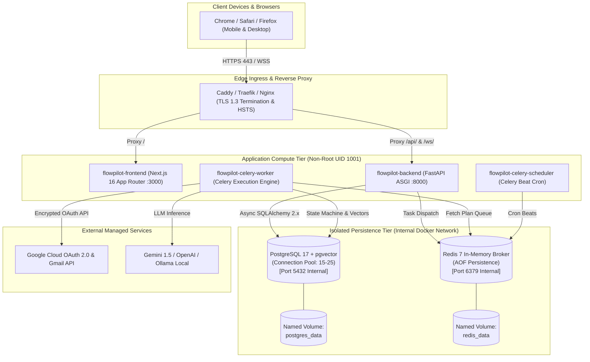

# FlowPilot AI — Production Architecture Specification

**System Version**: v1.0.0  
**Target Topology**: Containerized Distributed Architecture with High-Resilience Decoupled Services  
**Document Classification**: Production Engineering Guide  

---

## 1. System Topology & Architectural Ingress

FlowPilot AI operates as a containerized distributed platform designed for horizontal scalability, zero-trust workspace isolation, and fault-tolerant background execution.



---

## 2. Container Security & Non-Root Execution

All production container images are built using multi-stage compilation patterns with zero root privileges:

| Service | Base Image | Service User | UID:GID | Health Check Probe | Graceful Shutdown Signal |
| :--- | :--- | :--- | :--- | :--- | :--- |
| **`flowpilot-backend`** | `python:3.13-slim` | `appuser` | `1001:1001` | `curl -f http://localhost:8000/health` | `SIGTERM` (15s timeout) |
| **`flowpilot-celery-worker`**| `python:3.13-slim` | `appuser` | `1001:1001` | Celery inspect ping via broker | `SIGTERM` (60s grace period) |
| **`flowpilot-celery-scheduler`**| `python:3.13-slim` | `appuser` | `1001:1001` | Heartbeat schedule file | `SIGTERM` (15s timeout) |
| **`flowpilot-frontend`** | `node:22-alpine` | `nextjs` | `1001:1001` | `wget -qO- http://localhost:3000/` | `SIGTERM` (15s timeout) |
| **`flowpilot-postgres`** | `pgvector/pgvector:pg17`| `postgres` | `999:999` | `pg_isready -U flowpilot -d flowpilot_db` | `SIGINT` (Smart shutdown) |
| **`flowpilot-redis`** | `redis:7-alpine` | `redis` | `999:999` | `redis-cli ping` | `SIGTERM` |

### Hardened Container Rules
1. **Network Isolation**: PostgreSQL (`:5432`) and Redis (`:6379`) do not publish ports to `0.0.0.0`. They communicate solely across the private internal Docker bridge network (`flowpilotai_default`).
2. **Minimal Layer Footprint**: Compilation tools (`build-essential`, `libpq-dev`) are isolated in build stages and removed from final production runtime containers.
3. **Graceful Worker Drain**: `flowpilot-celery-worker` is assigned a `stop_grace_period: 60s` to complete in-flight DAG tasks before container termination.

---

## 3. Database Resilience, Pooling & Vector Search

### 3.1 Connection Pooling
In production, SQLAlchemy 2.x asyncpg engines manage an optimized connection pool:
- `pool_size`: 15 baseline persistent connections
- `max_overflow`: 10 burst connections (25 concurrent connections max)
- `pool_timeout`: 30.0 seconds
- `pool_recycle`: 1800 seconds (recycles idle connections every 30 minutes to prevent stale socket drops)
- `pool_pre_ping`: `True` (validates connection vitality before handing to request workers)

### 3.2 Dual-Mode Engine Architecture
```
                  ┌──────────────────────────────┐
                  │ Request: get_db() Dependency │
                  └──────────────┬───────────────┘
                                 │
                  ┌──────────────▼───────────────┐
                  │ Active PostgreSQL Database?  │
                  └───────┬──────────────┬───────┘
                          │              │
                   YES    │              │ NO (Connection Refused)
                          ▼              ▼
              ┌─────────────────────┐  ┌─────────────────────────┐
              │ Primary Engine      │  │ Resilient SQLite Engine │
              │ PostgreSQL 17       │  │ flowpilot.db            │
              │ (pgvector cosine)   │  │ (Automatic Fallback)    │
              └─────────────────────┘  └─────────────────────────┘
```
- In cloud deployments, primary PostgreSQL with pgvector operates as the source of truth.
- In low-resource or local disaster recovery scenarios, the backend automatically engages SQLite resilience without crashing API consumers.

---

## 4. Operational Health & Probing Topology

The platform exposes dual-tier health endpoints for orchestration controllers (Docker Compose, Kubernetes, AWS ECS, Render):

### 1. Liveness Probe (`GET /health`)
- **Purpose**: Fast check indicating process execution.
- **Payload**:
  ```json
  {
    "status": "healthy",
    "service": "FlowPilot AI",
    "version": "1.0.0",
    "environment": "production",
    "mode": "production-ready"
  }
  ```
- **HTTP Code**: 200 OK.

### 2. Readiness Probe (`GET /ready`)
- **Purpose**: Deep dependency validation verifying active PostgreSQL connection (`SELECT 1`) and Redis heartbeat (`PING`).
- **Payload**:
  ```json
  {
    "status": "ready",
    "database": {
      "healthy": true,
      "engine": "postgresql",
      "fallback_mode": false
    },
    "redis": {
      "healthy": true
    },
    "service": "FlowPilot AI",
    "version": "1.0.0",
    "environment": "production"
  }
  ```
- **HTTP Code**: `200 OK` if database is connected; `503 Service Unavailable` if database is unreachable.

---

## 5. Security Architecture & Threat Defenses

| Threat Vector | Platform Defense Mechanism | Specification |
| :--- | :--- | :--- |
| **Credential Theft at Rest** | Fernet AES-256 Symmetric Encryption | Keys derived from PBKDF2/cryptography, tokens encrypted before DB write |
| **Session Impersonation** | Argon2id Password Hashing | RFC 9106 parameterization (`memory=65536, time_cost=3, parallelism=4`) |
| **Cross-Tenant Data Leakage**| Strict Workspace Scoping | Every SQL query and pgvector search mandates `WHERE workspace_id = :ws_id` |
| **OAuth CSRF & Replay** | Signed HMAC-SHA256 State Tokens | State tokens contain encrypted workspace binding with 10-minute expiration |
| **Duplicate External Actions**| Cryptographic Idempotency Hash | Approval tokens hashed with payload; repeated actions rejected with HTTP 400 |
| **Prompt Injection** | Strict Boundary Delimiters | Untrusted user data enclosed in `<untrusted_user_content>` delimiters |
| **Clickjacking / MIME Sniffing**| Security Headers Middleware | `X-Frame-Options: DENY`, `X-Content-Type-Options: nosniff`, HSTS 1 year |
| **Denial of Service** | Application Rate Limiting | Configurable 120 req/min per IP threshold on authenticated routes |
