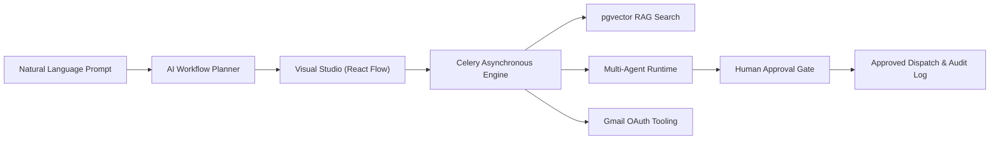

# FlowPilot AI — SaaS Product Overview

## 1. Executive Summary

**FlowPilot AI** is an enterprise-grade autonomous AI workflow automation platform designed for modern operations, engineering, and support teams. It bridges natural language intent, deterministic DAG orchestration, multi-agent AI execution, retrieval-augmented generation (RAG), and human-in-the-loop governance.

With FlowPilot, organizations can:
- **Synthesize Workflows with AI**: Convert plain-English operational descriptions into validated, multi-step execution graphs.
- **Visual Drag-and-Drop Studio**: Design, edit, configure, and inspect topological DAG graphs with typed parameter propagation.
- **Durable Multi-Agent Orchestration**: Coordinate specialized agents (Planner, Analyst, Researcher, Executor, Validator) asynchronously via Celery with automatic crash recovery, idempotency protection, and iteration limits.
- **Enterprise Knowledge Base (RAG)**: Search and retrieve document chunks via vector embeddings stored in PostgreSQL with `pgvector`, complete with source attribution and workspace tenant isolation.
- **Google Gmail Integration**: Safely read unread emails, classify urgency, draft intelligent responses, and enforce explicit human approval before external message dispatch.
- **Human Approval Center**: Inspect, edit, and approve or reject high-impact proposals with immutable audit logging.
- **Deep Observability**: Track step latency, token consumption, estimated costs, handoffs, tool calls, and execution timelines in real-time.

---

## 2. Key Features & Capabilities

### 2.1 Visual Workflow Studio & DAG Engine
- **14 Registered Node Types**:
  - *Triggers*: `manualTrigger`, `scheduleTrigger` (cron), `gmailTrigger`, `webhookTrigger`.
  - *AI & Retrieval*: `knowledgeRetrieve` (RAG), `aiAgent`, `llmCompletion`, `textClassifier`, `dataExtractor`, `textSummarizer`, `informationExtractor`, `aiDecision`.
  - *Logic & Utilities*: `condition`, `transform`, `delay`, `notification`.
  - *Governance & Output*: `humanApproval`, `httpIntegration`, `output`.
- **Topological Sorting & Cycle Detection**: Kahn's algorithm validates acyclic dependencies prior to execution.
- **Version Control & Publishing**: Immutable version snapshots with draft editing, version comparison, and live activation.

### 2.2 Durable Multi-Agent Orchestration
- **Specialized Agent Roles**:
  - `AnalystAgent`: Analyzes payloads, triages incidents, scores severity, and classifies intent.
  - `ResearcherAgent`: Executes workspace-scoped vector queries against indexed company documents.
  - `ExecutorAgent`: Resolves tool calls, maps parameters, and interacts with external APIs.
  - `ValidatorAgent`: Verifies safety boundaries, hallucination risks, and compliance policies.
  - `MultiAgentSupervisor`: Oversees handoffs, manages iteration limits, and aggregates final synthesized outcomes.
- **Crash Recovery & Idempotency**:
  - SHA-256 idempotency key prevents duplicate side effects even across worker crashes and restarts.
  - Recovery routines skip completed tasks and restore handoff dependencies automatically.

### 2.3 Real Vector Knowledge Retrieval (RAG)
- Powered by PostgreSQL with `pgvector` extension (and transparent zero-dependency fallback).
- Multi-tenant workspace isolation guarantees zero cross-tenant document exposure.
- Computes cosine vector similarity and returns chunk contents, source filenames, and execution latency traces.

### 2.4 Google Gmail OAuth 2.0 Integration
- Cryptographic state validation with signed HMAC-SHA256 tokens (10-minute expiry).
- Symmetric encryption of tokens at rest using Fernet AES-256.
- Automatic background refresh of expired access tokens using encrypted refresh tokens.
- Immediate token revocation on disconnect via Google OAuth revocation endpoint.
- Strictly gated: `gmail.send_email` cannot execute without explicit human approval.

### 2.5 Human Approval Center
- Halts execution at critical decision points (e.g. sending emails or external webhooks).
- Allows operators to review proposed drafts, make inline edits to subject or body, and approve or reject.
- Rejection halts execution cleanly with status `CANCELLED` and no side effects.
- Duplicate or replayed decisions are rejected with HTTP 400.

### 2.6 Real-Data Dashboard & Analytics
- 100% database-backed metrics: total workflows, active workflows, execution pass/fail rates, latency trends.
- AI token consumption accounting and estimated USD costs.
- Recent agent activity telemetry and immutable audit log stream.

---

## 3. Pre-Configured Production Templates

FlowPilot includes 7 out-of-the-box functional templates built with valid DAG schemas:

| Template Name | Category | Pipeline Nodes |
| :--- | :--- | :--- |
| **Email Priority Classification** | Triaging & Support | `manualTrigger` $\rightarrow$ `textClassifier` $\rightarrow$ `notification` |
| **Executive Email Summarization** | Productivity | `manualTrigger` $\rightarrow$ `textSummarizer` $\rightarrow$ `notification` |
| **Knowledge-Base Semantic QA** | Enterprise RAG | `manualTrigger` $\rightarrow$ `knowledgeRetrieve` $\rightarrow$ `llmCompletion` $\rightarrow$ `output` |
| **Structured Document Extraction** | Finance & Ops | `manualTrigger` $\rightarrow$ `dataExtractor` $\rightarrow$ `output` |
| **AI Research & Report Generation** | Autonomous Agents | `manualTrigger` $\rightarrow$ `knowledgeRetrieve` $\rightarrow$ `aiAgent` $\rightarrow$ `llmCompletion` $\rightarrow$ `output` |
| **Approval-Based Email Response** | Customer Operations | `manualTrigger` $\rightarrow$ `textClassifier` $\rightarrow$ `aiAgent` $\rightarrow$ `humanApproval` $\rightarrow$ `output` |
| **Daily Scheduled Content Digest** | Scheduled Automation | `scheduleTrigger` $\rightarrow$ `knowledgeRetrieve` $\rightarrow$ `textSummarizer` $\rightarrow$ `notification` |

---

## 4. Security & Compliance Principles

1. **Untrusted Data Fencing**: All external emails and documents are enclosed in `<untrusted_user_content>` delimiters with adversarial prompt defense instructions.
2. **Secret Redaction**: API keys and OAuth Bearer tokens are automatically replaced with `[REDACTED]` in all traces and logs.
3. **Password Security**: Argon2id hashing conforming to RFC 9106.
4. **Tenant Isolation**: Every database query, knowledge chunk search, and integration check enforces `workspace_id` scoping.
