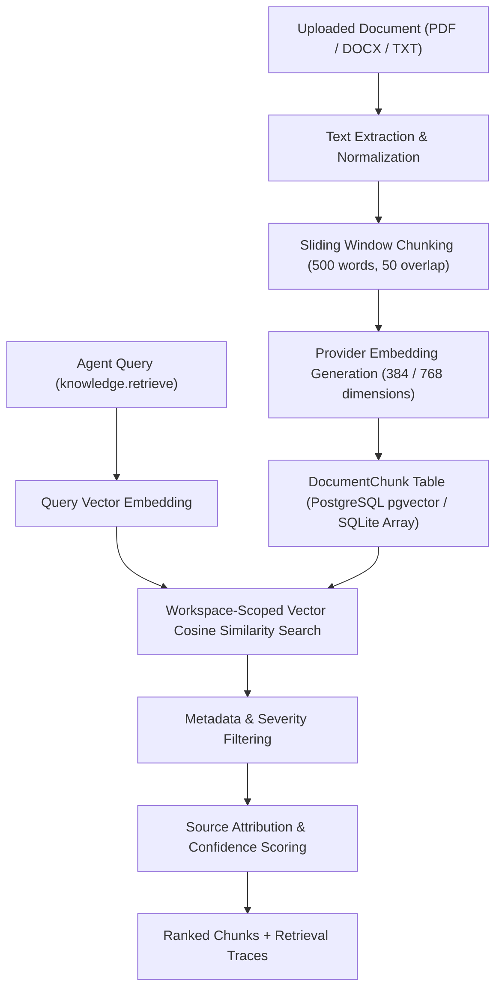

# FlowPilot AI — RAG Architecture & Vector Retrieval

## 📌 Architecture Overview

FlowPilot AI implements an end-to-end Retrieval-Augmented Generation (RAG) subsystem designed for enterprise knowledge search, multi-tenant workspace isolation, and factual grounding for autonomous agents.



---

## 🗄️ Document Parsing & Chunking

1. **Format Extractors**:
   - PDF: Parsed page-by-page via `pypdf.PdfReader`.
   - DOCX: Parsed paragraph-by-paragraph via `python-docx`.
   - Plain text: UTF-8 encoded text streams.
2. **Chunking Strategy**:
   - Sliding word window: Default size of 500 words with 50-word overlap.
   - Prevents context truncation across sentence and paragraph boundaries.
   - Preserves semantic continuity between consecutive chunks.
3. **Chunk Metadata**:
   - Each chunk retains `chunk_index`, `char_length`, `word_count`, and user-defined tags/filters.

---

## 🧠 Vector Similarity & Dual-Mode Storage

- **PostgreSQL 17 + pgvector**:
  Production deployments utilize PostgreSQL's pgvector extension for sub-millisecond vector indexing and `<=>` cosine distance calculations.
- **SQLite Zero-Dependency Fallback**:
  For rapid local development, CI pipelines, and environments without PostgreSQL, embeddings are stored as structured JSON arrays, and similarity is calculated using an in-memory normalized cosine similarity routine:
  $$\text{Cosine Similarity}(\vec{u}, \vec{v}) = \frac{\vec{u} \cdot \vec{v}}{\|\vec{u}\| \|\vec{v}\|}$$

---

## 🛡️ Workspace Isolation & Attributions

1. **Strict Multi-Tenant Scoping**:
   Every search joins `DocumentChunk` $\rightarrow$ `Document` $\rightarrow$ `KnowledgeBase` and filters on `KnowledgeBase.workspace_id == current_workspace_id`.
   Cross-workspace document retrieval is physically impossible at the database query level.
2. **Document Attribution**:
   Every retrieved chunk returns clear attribution:
   - `document_id`
   - `filename`
   - `chunk_index`
   - `similarity_score`
   - `metadata`
3. **Execution Tracing**:
   Each retrieval records a telemetry trace containing:
   - `query`
   - `chunks_evaluated`
   - `matched_count`
   - `top_k`
   - `duration_ms`

---

## 🔧 Integration with Agent Runtime

The `knowledge.retrieve` agent tool connects directly to `RAGService.search_workspace`:
```python
tool_output = await invoke_tool(
    "knowledge.retrieve",
    {"query": "cluster outage SLA escalation", "top_k": 3},
    ToolContext(workspace_id=workspace_id, permissions={"knowledge:read"}, db=db),
)
```
- Safe handling of empty results: If no matching documents exist, an empty list with query trace is returned without errors.
- Never fabricates retrieved documents or search results.
